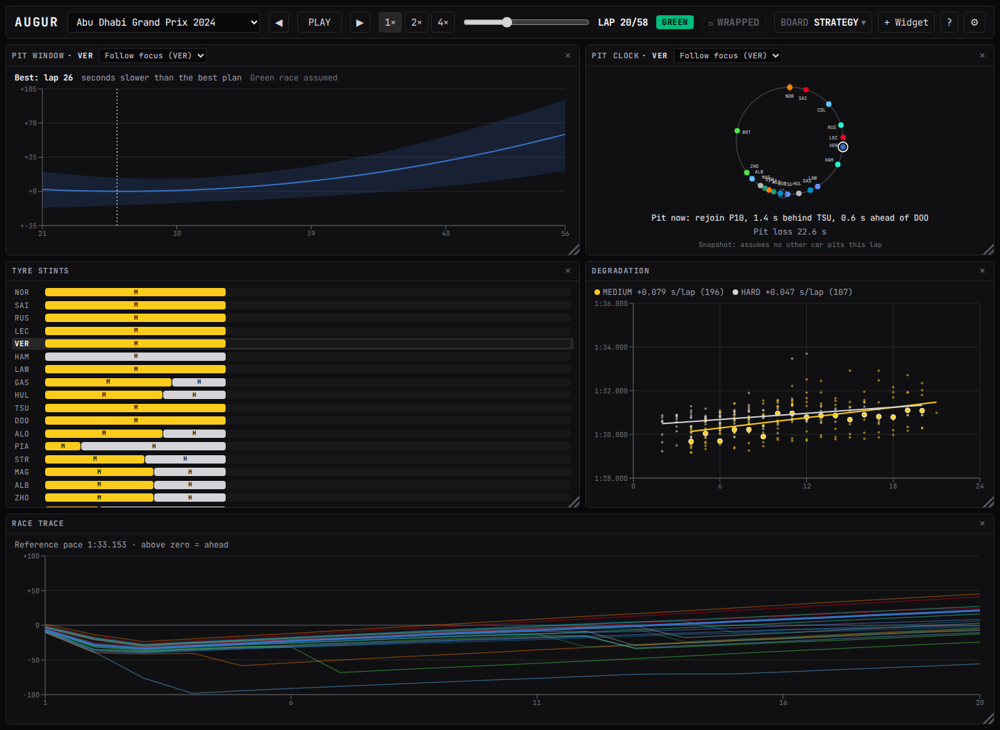
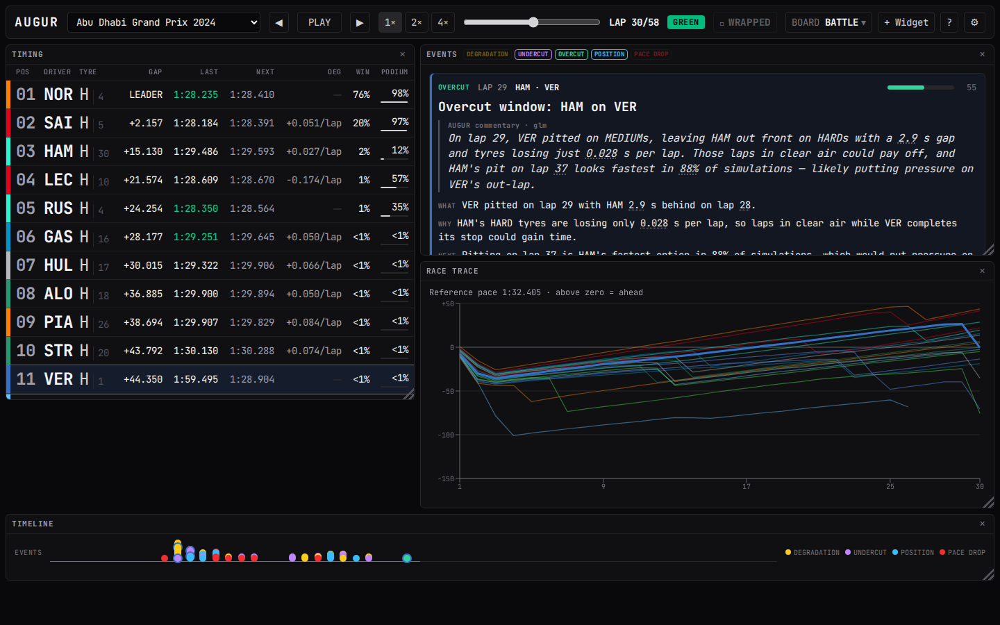
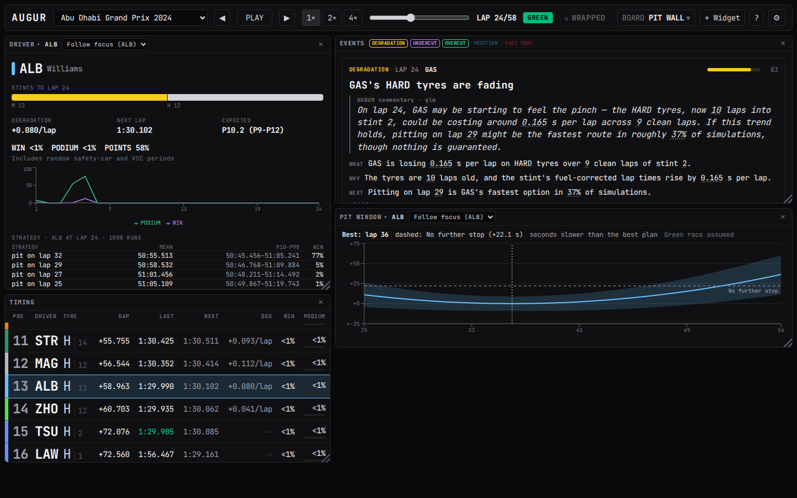
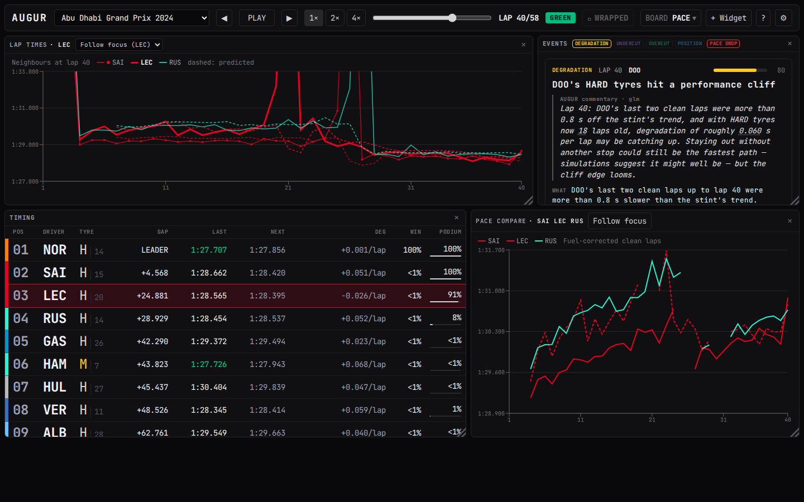
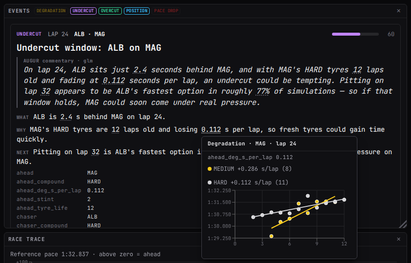
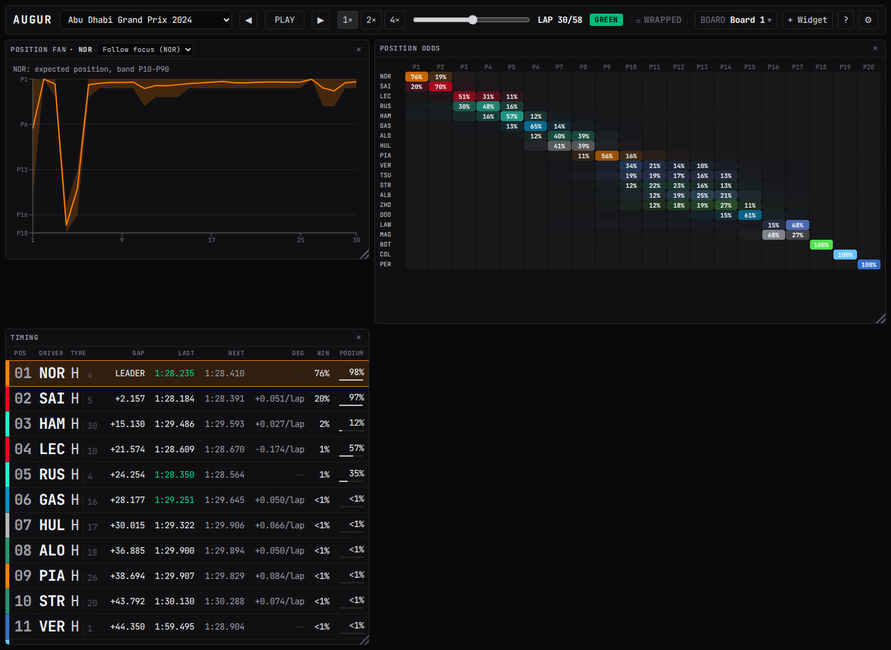
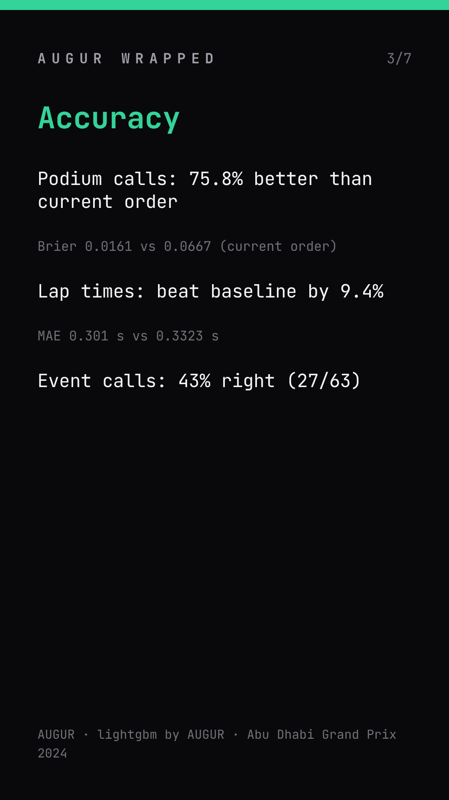
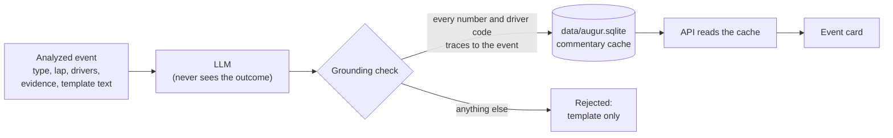

**English** | [繁體中文](README.zh-TW.md)

# AUGUR — F1 Race Intelligence

AUGUR replays a Formula 1 race lap by lap and explains it the way an analyst on the pit wall would: who is likely to finish where, which tyres are fading, when a pit stop would pay off, and why each moment in the race mattered. Every number on screen at lap N is computed only from laps up to N, so the replay never knows how the race ends. You can plug in your own lap-time model and see its benchmark score in an end-of-race "Wrapped" summary.

[](https://github.com/Errha-la/augur/actions/workflows/ci.yml) MIT, see [LICENSE](LICENSE).



## Quick start

Needs Python 3.12 or newer, Node.js 20 or newer, `make`, and network access for the first download. No account, subscription, or API key is needed.

```bash
make setup      # creates backend/.venv, installs the backend with dev extras, runs npm ci in frontend/
make demo       # ingests 22 races from OpenF1, trains lightgbm, analyzes 2024 Bahrain and Abu Dhabi
make dev-api    # terminal 1: the API on http://localhost:8000
make dev-web    # terminal 2: the dashboard on http://localhost:5173
```

Open http://localhost:5173 and pick a race. `make test` runs the offline backend tests and the frontend tests.

- The first `make demo` downloads from the public [OpenF1](https://openf1.org) API: 575 s on 2026-11-19; on 2026-11-22 a slow OpenF1 needed four runs (1,534 s in total). If a round fails, for example with an OpenF1 timeout, run `make demo` again: downloaded responses stay cached in `data/openf1-cache/`.
- If `python3 -m venv` fails or the venv has no pip (Ubuntu without `python3.X-venv`), `make setup` prints the fallback commands and stops; see [Manual setup](#manual-setup).
- LLM commentary is optional and not part of `make demo`; see [LLM commentary](#llm-commentary-optional).

## Features

All screenshots: 2024 Abu Dhabi Grand Prix, model `lightgbm`, real API on this machine.

### Lap-by-lap replay



Pick a race and move through it lap by lap, or play it at 1×, 2×, or 4×. At lap N the dashboard shows only what was knowable at the end of lap N: the running order, gaps, tyres, the lap-time model's prediction for each driver's next lap, the events detected so far, and finishing-position odds.

| Control | Action |
|---|---|
| Race selector | switch race (restarts at lap 1) |
| Slider, ◀ / ▶, Left / Right | move one lap |
| PLAY / Space, 1× 2× 4× | play one lap per 1000 / 500 / 250 ms |
| Timing row | set the focus driver (focus panel, driver widgets, highlights) |
| Event timeline marker | jump to that event's lap and pause |

If the API is not running, the dashboard shows how to start it; if no race is ingested or a race is not analyzed, it shows the command to run.

### The whiteboard: boards and widgets

The dashboard is a whiteboard of widgets on a 12-column grid. Pick a preset board or build your own:

| Board | Widgets |
|---|---|
| **BATTLE** (default) | timing, events (position changes, undercut and overcut windows), race trace, timeline |
| **PIT WALL** | focus driver, events (degradation, undercut and overcut windows), pit window, timing |
| **PACE** | lap times, events (pace drops, degradation), timing, pace compare |
| **STRATEGY** | pit window, pit clock, tyre stints, degradation, race trace |

- Drag a widget by its title bar and resize it from the corner; with a widget focused, arrow keys move it and Shift+arrow keys resize it.
- "+ Widget" adds any of the 13 widget types below, and the same type can be added more than once. Driver widgets (Driver, Lap times, Pit clock, Pit window, Position fan) each follow the focus driver or are pinned to one driver, so a board can show the pit window of LEC next to the pit window of PIA.
- "New blank board" starts an empty board. Boards are saved only in this browser (`localStorage`, key `augur.boards.v1`); share one with Export / Import (`augur-board-<name>.json`, at most 100 KB and 24 widgets). Nothing about boards is stored on the server.
- "?" in the status bar reopens the four-step guide.





#### What each chart shows and how it is computed

Every widget asks the API for the replay lap N and gets numbers computed only from laps up to N. Two definitions are used throughout:

- **Clean lap** (`augur.features.clean_mask`): has a lap time, is not lap 1, is neither a pit-in nor a pit-out lap, runs under green flags on a dry compound, and is at most 10% slower than the fastest earlier clean lap of the race.
- **Fuel-corrected lap time** (`augur.features.fuel_corrected`): the lap time as if the car still carried the full fuel load, `lap time + 0.03 s/kg × 110 kg ÷ race laps × (lap − 1)`, so laps late in the race are comparable with early ones.

| Widget | Shows | Reads | How it is computed |
|---|---|---|---|
| Timing | running order, gap, tyre and its age, last and predicted next lap, degradation, win and podium probability | `/state`, `/predictions`, `/positions` | Position from laps completed, then session time at each driver's last lap (can differ from official timing around pit stops); next lap and degradation as in Lap times; probabilities from the position simulation below. |
| Events | event cards with what / why / next analysis and optional LLM commentary | `/events` | Rule-based detectors run lap by lap: tyre degradation warning (a stint fit of at least 0.10 s/lap over at least 8 clean laps), undercut and overcut windows, position change, pace drop. Text is deterministic templates; an event's outcome appears only once the replay reaches its outcome lap. |
| Driver | focus driver: stints, degradation, predicted next lap, expected position with its P10-P90 range, win / podium / points (top 10) odds with their history, and a pit strategy table | `/state`, `/predictions`, `/positions/history`, `/strategy` | Probabilities from the position simulation. The strategy table compares four candidate plans, a stop on lap N+1, N+3, N+5, or N+8 (plus "no further stop" once two dry compounds are used), over 1,000 seeded runs; "win" is the share of runs in which that plan is the fastest. Assumes a green race to the end. |
| Lap times | lap times of the driver and the cars just ahead and behind, with the model's predicted laps as dashed lines | `/laps`, `/predictions` | Prediction = recent pace (median of the last 3 clean laps) + the lap-time model's predicted delta (`lightgbm` by default; swappable, see [Plug in your model](#plug-in-your-model)). |
| Timeline | every event as a marker along the race | `/events` | Clicking a marker jumps to that lap and pauses. |
| Race trace | each driver's time gained (+) or lost (−) against a reference pace, per lap | `/trace` | Race time = session time − race start, where race start is the median over drivers of (lap-1 session time − lap-1 lap time). Reference pace = median over drivers of race time ÷ laps at their last timed lap. A flat line holds the reference pace; a rising line is faster. |
| Pit clock | every car's gap to the leader and where the driver would rejoin if it pitted now | `/rejoin` | Rejoin gap = own gap to the leader + pit loss. Pit loss = median over the race's stops so far of (in-lap + out-lap − 2 × that driver's recent pace), or 22 s before any stop. Other cars are assumed not to pit; a snapshot, not a forecast. |
| Pit window | expected remaining race time for a stop on each remaining lap, and the best lap | `/pit-window` | The strategy simulator (below), 1,000 runs with seed 42 for every candidate pit lap, with a pit-loss draw of SD 1.5 s per run. "No further stop" is offered only once the driver has used two dry compounds, the same rule as the strategy table. It scans every remaining lap, while the strategy table and event text compare only N+1, N+3, N+5, and N+8, so its best lap can differ from theirs (lap 36 against lap 32 for ALB at lap 24 in the PIT WALL screenshot). Assumes a green race. |
| Tyre stints | each driver's stints so far, coloured by compound | `/stints` | Compound, start lap, end lap, and tyre age at the stint start, from the lap data. |
| Degradation | fuel-corrected clean laps against tyre age, per dry compound, with a fitted line | `/degradation` | Least-squares line `time = intercept + slope × tyre age` per compound, drawn from 4 points on; the slope is the degradation in s/lap. |
| Pace compare | fuel-corrected clean laps of up to four drivers | `/degradation` | The same points as Degradation, filtered to the chosen drivers (or the focus driver and its neighbours). |
| Position fan | expected finishing position per lap with a P10-P90 band | `/positions/history` | The position simulation stored at every lap: the mean finishing position and its 10th and 90th percentiles over the runs. |
| Position odds | probability of every finishing position for every driver (heatmap) | `/positions/distribution` | The share of the position simulation's runs in which a driver finishes P1, P2, and so on. |

**Position simulation** (`augur.positions`, 1,000 seeded runs, simulated from lap N + 1 to the flag for the whole field). One simulated lap of a driver is

`recent pace + model delta × 0.7^(laps ahead − 1) + degradation × added tyre age − fuel burn + noise`

- The lap-time model's predicted delta fades by a factor 0.7 per lap, so a one-lap forecast does not become a race-long gap.
- Degradation uses the driver's own stint fit only with at least 8 clean laps and a non-negative slope; otherwise a guarded slope for the compound (the median of stint fits, shrunk toward a circuit prior), always clamped to 0-0.20 s/lap.
- Each run draws one pace offset per driver (SD 0.30 s) that lasts the whole run, so cars are not just independent coin flips every lap.
- A car finishing a lap less than 1.0 s behind the car ahead loses 0.4 s on the next lap (dirty air).
- A simulated stop adds the pit loss and restarts the tyres on the next compound, with a pace offset per compound (SOFT −0.6 s, MEDIUM 0, HARD +0.4 s per lap).
- A run may contain a safety car (0.8% chance per lap, 4 laps) or a virtual safety car (0.6% per lap, 3 laps): laps 1.35× / 1.25× slower for everyone, stops at 0.5× / 0.6× the pit loss, gaps closed to 1.0 s behind a safety car, and a driver still due a stop takes it then with probability 0.8.
- Finishing order per run is by laps completed, then total time.
- The delta fade (0.7) and the pace offset (0.30 s) were tuned with `augur.tune_sim` on 2024 rounds 12 to 23 only; the safety-car and VSC rates are estimates (about 0.45 safety cars and 0.35 VSCs per 57-lap race) checked against race-control counts on those races. None of them was fitted on the benchmark races (see [Benchmark](#benchmark)).

The **strategy simulator** behind Pit window and the strategy table (`augur.strategy`) simulates one driver: `lap time = fuel-corrected pace at tyre age 0 + degradation × tyre age − fuel burn + noise`, where a stop adds the pit loss, resets the tyre age, and changes pace by the compound offset. It compares pit plans by total race time over 1,000 seeded runs and assumes a green race.

### Race events with clickable numbers



A rule-based event engine steps through the race lap by lap and writes each event as **what** happened, **why** it matters, and what could come **next**, in an analyst's voice: probabilities, never instructions.

| Event | Fires when (thresholds in `backend/src/augur/config.py`) |
|---|---|
| Tyre degradation warning | a stint's fuel-corrected lap times rise by at least 0.10 s/lap over at least 8 clean laps, or the last two clean laps are more than 0.8 s off the stint's trend (a "cliff") |
| Undercut window | a driver is within 2.5 s of the car directly ahead, whose tyres are at least 12 laps old, and neither has pitted in the last 3 laps |
| Overcut window | the car directly ahead pits while the driver, within 3.0 s, stays out on tyres losing at most 0.05 s/lap |
| Position change | a driver gains or loses at least 2 places in one lap, or a new leader |
| Pace drop | a clean lap is more than 1.0 s slower than the model predicted |

- Undercut and degradation calls get an outcome 8 laps later (did the chaser get ahead, did the driver pit), shown only when the replay reaches that lap; the [benchmark](#benchmark) counts them as the event hit rate.
- Numbers that come from the event's evidence (gap, tyre age, degradation, lap times, pit lap and win share, positions) are underlined in the analysis and in the commentary. Clicking one opens a small chart of that value at the event's lap for the event's drivers: race trace, tyre stints, degradation, lap times, pit window, or position fan. Escape, a click outside, or a second click closes it.
- The backend computes these links in `/events` (`links.what` / `why` / `next` / `commentary`, code-point offsets) with the same number rules as the commentary grounding check, so a number is linked exactly when it traces to an evidence field. The event lap and template constants stay plain text, and a popover never reads laps after the event.
- Each Events widget filters by event type with the chips in its title bar.

### Finishing-position forecasts



The headline output is the probability of each finishing position for every driver, from a Monte Carlo simulation of the rest of the race (1,000 seeded runs at every lap, including random safety-car and VSC periods). The timing list shows win and podium odds, the Driver widget the full odds and expected position, the Position fan how the expected position moved lap by lap, and Position odds the whole field as a heatmap. How the simulation works is in the [chart catalogue](#what-each-chart-shows-and-how-it-is-computed); how well it scores is in [Benchmark](#benchmark).

### Race Wrapped



At the final lap, **WRAPPED** opens a race summary for the focus driver as seven story cards: Summary, Podium Call, Accuracy, Best Call, Biggest Miss, Biggest Moment, and the driver's own card. "Download card" saves each one as a 1080×1920 PNG for an Instagram story.

The Accuracy card scores the served model on this race alone: the card shown is Abu Dhabi 2024 for `lightgbm` (podium Brier 0.0161 against 0.0667 for "current order holds", lap-time MAE 0.301 s against 0.3323 s, 27 of 63 event calls right), the same numbers as the Abu Dhabi entry in `bench/lightgbm.json`. Plug in your own lap-time model and its Wrapped shows your score.

<br clear="right">

### LLM commentary (optional)

AUGUR can add a short commentator-style paragraph to every event, written by any LLM you point it at. The dashboard shows it at the top of the event card, labelled `AUGUR commentary · <model>` (see the event screenshot above). Nothing else depends on it: analysis, tests, the benchmark, and the API never call an LLM, and without commentary each event keeps its template analysis.

**Template and LLM side by side.** 2024 Abu Dhabi, lap 24, undercut window, ALB on MAG (model `lightgbm`, commentary `glm`), quoted unedited from `data/augur.sqlite`:

| Template analysis (deterministic) | AUGUR commentary (LLM) |
|---|---|
| **What** ALB is 2.4 s behind MAG on lap 24.<br>**Why** MAG's HARD tyres are 12 laps old and losing 0.112 s per lap, so fresh tyres could gain time quickly.<br>**Next** Pitting on lap 32 is ALB's fastest option in 77% of simulations, which would put pressure on MAG. | On lap 24, ALB sits just 2.4 seconds behind MAG, and with MAG's HARD tyres 12 laps old and fading at 0.112 seconds per lap, an undercut could be tempting. Pitting on lap 32 appears to be ALB's fastest option in roughly 77% of simulations — so if that window holds, MAG could soon come under real pressure. |

The LLM changes the voice, not the facts: every number in its text is one the template already had.

**How a text gets onto the screen.**



- The LLM gets the event type, lap, drivers, evidence, and template text, and never the event's outcome, so it cannot leak the future into the replay.
- A text is kept only if every number in it matches the event's lap, evidence, or template text, and every three-letter driver code belongs to the event; otherwise `augur.narrate` prints `rejected <event_id>: <reason>` and stores nothing for that event.
- Commentary is generated once per race by `augur.narrate` and cached; the API only reads the cache, so the dashboard never waits for an LLM.

Measured on 2024 Abu Dhabi (118 events) with a self-hosted `glm` server on 2026-11-23:

| Language | First run | Rerun | Length |
|---|---|---|---|
| English | 27 ok, 0 rejected, 2 failed (timeouts), 89 cached | 2 ok | 43–72 words, median 57 (25 over the prompt's 60-word limit) |
| Traditional Chinese | 117 ok, 1 rejected (a number not in the evidence), 0 failed | 1 ok | 74–128 characters, median 101 (8 over the 120-character limit) |

All 118 events end with grounded commentary in both languages. The English run regenerated 27 texts that no longer passed the grounding check after the race was re-analyzed with a recalibrated simulator; they were deleted from the cache first, since `augur.narrate` skips cached events.

#### Generate commentary

```bash
# after make demo (or augur.analyze); needs the narrator variables below
AUGUR_NARRATOR=openai_compat AUGUR_LLM_BASE_URL=http://<host>:<port>/v1 AUGUR_LLM_MODEL=<model> \
  backend/.venv/bin/python -m augur.narrate --race 2024-24-abu-dhabi-grand-prix
# narrated 2024-24-abu-dhabi-grand-prix: <ok> ok, <rejected> rejected, <failed> failed, <cached> cached
```

Run it again to retry rejected or failed events; cached events are skipped. Start the API (`make dev-api`) with the same narrator variables, since it serves only the commentary cached for the current settings. The variables can also live in a git-ignored `.env` file loaded with `set -a; source .env; set +a`.

#### Switch the LLM

| Variable | Default | Meaning |
|---|---|---|
| `AUGUR_NARRATOR` | `gemini` | `openai_compat` (any OpenAI-compatible server), `gemini`, or `none` (no commentary) |
| `AUGUR_LLM_BASE_URL` | — | base URL of the OpenAI-compatible server, `http://` or `https://`, ending in `/v1` (required for `openai_compat`) |
| `AUGUR_LLM_MODEL` | `glm` | model id on that server (see `GET <base URL>/models`) |
| `AUGUR_LLM_API_KEY` | — | optional; sent as `Authorization: Bearer <key>` |
| `GEMINI_API_KEY` | — | Gemini API key (required for `gemini`) |
| `GEMINI_MODEL` | `gemini-flash-latest` | Gemini model id; set a fixed id for reproducible text |
| `AUGUR_COMMENTARY_LANG` | `en` | `en` or `zh-TW`; the dashboard's Settings sheet overrides it (saved in `data/settings.json`) |

- **Any OpenAI-compatible server** (a local Ollama, vLLM, or LM Studio server, or a hosted provider): set `AUGUR_NARRATOR=openai_compat`, `AUGUR_LLM_BASE_URL` to its `/v1` base URL, `AUGUR_LLM_MODEL` to a model it serves, and `AUGUR_LLM_API_KEY` if it needs one. AUGUR posts to `<base URL>/chat/completions` with the Python standard library (no extra package), waits up to 120 s per event, retries HTTP 429 and 5xx twice, strips `<think>` blocks, and stops after 3 connection errors in a row (for example when the server is off your network).
- **Gemini:** `AUGUR_NARRATOR=gemini` and `GEMINI_API_KEY`; pin `GEMINI_MODEL` for reproducible text. A free-tier key ran out of quota before finishing one full race in our runs.
- **Off:** `AUGUR_NARRATOR=none`, or leave the variables unset: `augur.narrate` prints `<VARIABLE> not set; nothing generated` and exits 0.
- **Language:** `AUGUR_COMMENTARY_LANG=zh-TW`, or the language in the dashboard's Settings, for Traditional Chinese.
- **After switching**, run `augur.narrate` again and restart the API. Commentary is cached per event, model, narrator, LLM model, language, and prompt version (`augur.narration.cache`), so texts from the old settings stay in the cache and come back if you switch back.

**Add a provider** for an API that is not OpenAI-compatible. A narrator is any class with a `name` and a `narrate(event) -> str | None` method (`augur.narration.base.Narrator`):

1. Write the class and call `register(name, factory)` in a new module, for example `backend/src/augur/narration/my_llm.py` (below).
2. Import that module in `backend/src/augur/narration/__init__.py`, next to the `gemini` and `openai_compat` imports, so the name is registered.
3. Add the name and a function returning its configured model id to `_CONFIGURED_MODEL` in `backend/src/augur/narration/serving.py`; the API serves commentary only for narrators listed there.
4. Run `augur.narrate` and the API with `AUGUR_NARRATOR=<name>`.

```python
# backend/src/augur/narration/my_llm.py
import os
from augur.narration.base import MissingSettingError, register
from augur.narration.prompt import build_prompt

class MyNarrator:
    name = "my_llm"
    llm_model = "my-model"          # stored with each text and shown on the card

    def __init__(self):
        self.key = os.environ.get("MY_LLM_KEY")
        if not self.key:
            raise MissingSettingError("MY_LLM_KEY")   # augur.narrate prints "MY_LLM_KEY not set" and exits 0
        self.lang = "en"            # set by augur.narrate from the language setting

    def narrate(self, event):
        prompt = build_prompt(event, self.lang)
        return call_my_llm(prompt, self.key)          # your client; return None on failure

register(MyNarrator.name, MyNarrator)
```

The grounding check runs on whatever your narrator returns, so a new provider cannot put an unsupported number on screen.

## Benchmark

**Finishing-position forecasts beat "current order holds" by 49.8%** (podium Brier skill, 2024 Bahrain and Abu Dhabi, `lightgbm`), and by 4.2% on twelve held-out 2024 races (rounds 12 to 23). All numbers below come from the committed `bench/*.json` files (generated 2026-11-22, seed 42) and can be reproduced with the commands at the end of this section.

**Headline score: podium skill.** At 25%, 50%, and 75% race distance, every driver's simulated podium probability `p_podium` is scored with the Brier score against whether the driver finished on the podium, and compared with the rule "the current top 3 finish on the podium": `skill = 1 − Brier(model) ÷ Brier(current order)`. Positive means better than that rule.

| Benchmark races | Podium skill | Brier (model / current order) | Log loss (model / current order) | Lap-time MAE (model / baseline) | Event hit rate |
|---|---|---|---|---|---|
| `lightgbm`, both races | **49.8%** | 0.0251 / 0.05 | 0.0828 / 0.3463 | 0.305 s / 0.3802 s (19.8% better) | 44.5% (61/137) |
| `lightgbm`, 2024 Bahrain | −2.2% | 0.0341 / 0.0333 | 0.1016 / 0.2312 | 0.3086 s / 0.4221 s (26.9%) | 34/74 |
| `lightgbm`, 2024 Abu Dhabi | 75.8% | 0.0161 / 0.0667 | 0.064 / 0.4615 | 0.301 s / 0.3323 s (9.4%) | 27/63 |
| `baseline`, both races | 49.6% | 0.0252 / 0.05 | 0.0844 / 0.3463 | 0.3802 s / 0.3802 s (0.0%) | 44.5% (61/137) |
| `baseline`, 2024 Bahrain | −8.1% | 0.036 / 0.0333 | 0.1091 / 0.2312 | — | 34/74 |
| `baseline`, 2024 Abu Dhabi | 78.4% | 0.0144 / 0.0667 | 0.0598 / 0.4615 | — | 27/63 |

| Evaluation races (2024 rounds 12 to 23) | Podium skill | Brier (model / current order) | Log loss (model / current order) | Lap-time MAE (model / baseline) | Event hit rate |
|---|---|---|---|---|---|
| `lightgbm` | 4.2% | 0.0745 / 0.0778 | 0.276 / 0.5382 | 0.419 s / 0.4852 s (13.6% better) | 41.7% (366/877) |
| `baseline` | 2.7% | 0.0757 / 0.0778 | 0.2819 / 0.5382 | 0.4852 s / 0.4852 s (0.0%) | 41.7% (366/877) |

How to read it:

- **Most of the podium skill comes from the simulator, not the lap-time model.** `baseline` predicts a lap-time delta of 0 (next lap = recent pace), and its forecasts score almost the same (49.6% against 49.8%). `lightgbm` predicts lap times clearly better (MAE 19.8% lower on the benchmark races, 13.6% on the evaluation races), but the simulator fades that one-lap delta (factor 0.7 per lap), so it moves the finishing odds only a little.
- **Per-race skill varies widely.** Bahrain is slightly worse than "current order holds" for both models, Abu Dhabi far better; on the evaluation races it ranges from −430.1% (Hungary) to 65.2% (Belgium), with Singapore at −110.3%.
- **Forecasts above 0.8 are overconfident** on the evaluation races: 73 forecasts with a mean of 0.936 came true 75.3% of the time.
- **Event hit rate** scores undercut and degradation calls 8 laps later (hit / miss / void). These rules do not use the lap-time model, so every model gets the same rate.

**Method.** The lap-time model is trained on 2024 rounds 2 to 11 (8,161 clean laps; 1,773 test laps in Bahrain and Abu Dhabi). Each circuit's degradation prior comes from the 2023 race at the same track; OpenF1 has no earlier data, so Shanghai and Imola (no 2023 race) have none. The simulator's model-delta fade and per-run pace offset were tuned on rounds 12 to 23 only, and its safety-car and VSC rates were checked against those races. The benchmark races are never in a model's training set, but the training races come after Bahrain in the season, so the model has seen 2024 car behaviour from later in the year.

Reproduce:

```bash
backend/.venv/bin/python -m augur.train --model baseline   # once: the baseline is not part of make demo
backend/.venv/bin/python -m augur.analyze --race 2024-01-bahrain-grand-prix --model baseline
backend/.venv/bin/python -m augur.analyze --race 2024-24-abu-dhabi-grand-prix --model baseline
backend/.venv/bin/python -m augur.bench --model lightgbm   # writes bench/lightgbm.json
backend/.venv/bin/python -m augur.bench --model baseline   # writes bench/baseline.json
```

`--eval` scores the evaluation races instead and writes `bench/<model>-eval.json`; it needs 2024 rounds 12 to 23 ingested (`python -m augur.ingest --year 2024 --rounds 12 13 14 15 16 17 18 19 20 21 22 23`) and analyzed for the model.

## Plug in your model

Only the lap-time model is swappable: it predicts each driver's next clean lap as recent pace (median of the last 3 clean laps) plus a delta. Implement the `LapTimeModel` protocol, select it by name, train, analyze, and run `augur.bench`; the dashboard and Wrapped then show your model's forecasts and score. The position simulator, degradation, and strategy stay fixed so scores are comparable. Step by step: [docs/swap-model.md](docs/swap-model.md).

## API

`make dev-api` serves the API on http://localhost:8000; the dashboard's dev server proxies `/api` to it, and CORS allows `http://localhost:5173`. Every race endpoint takes `lap=N` and reads only laps up to N. Prediction, event, and position endpoints use the model named by `AUGUR_MODEL` (default `lightgbm`; also set from the dashboard's Settings); an unknown or untrained model returns HTTP 503.

| Endpoint | Returns |
|---|---|
| `GET /api/health` | `{"status": "ok"}` |
| `GET /api/races` | ingested races ordered by year, round |
| `GET /api/settings`, `PUT /api/settings` | served model, commentary language, data source; read-only commentary settings (narrator, LLM model) |
| `GET /api/races/{race_id}/state?lap=N` | track status and per-driver position, gap, tyre, stint, pit count |
| `GET /api/races/{race_id}/laps?lap=N[&driver=D]` | normalized lap rows with lap ≤ N |
| `GET /api/races/{race_id}/predictions?lap=N` | per driver: predicted next lap time, recent pace, tyre degradation per lap, cliff flag |
| `GET /api/races/{race_id}/events?lap=N` | events up to lap N with what / why / next, evidence, outcome once decided, cached commentary, and number links |
| `GET /api/races/{race_id}/positions?lap=N` | per driver: win, podium, and points probability, expected position |
| `GET /api/races/{race_id}/positions/history?lap=N` | the same for every lap up to N, with `position_p10` / `position_p90` |
| `GET /api/races/{race_id}/positions/distribution?lap=N` | finishing-position probabilities P1..Pn per driver |
| `GET /api/races/{race_id}/strategy?lap=N&driver=D[&runs=1000&seed=42]` | candidate pit plans compared by a seeded Monte Carlo simulation (mean, p10, p90, win share) |
| `GET /api/races/{race_id}/pit-window?lap=N&driver=D[&runs&seed]` | simulated remaining race time for a stop on every remaining lap, best pit lap |
| `GET /api/races/{race_id}/rejoin?lap=N&driver=D` | gaps to the leader and where D would rejoin if it pitted now |
| `GET /api/races/{race_id}/trace?lap=N` | race trace: each driver's time gained or lost against a reference pace, per lap |
| `GET /api/races/{race_id}/stints?lap=N` | tyre stints so far per driver |
| `GET /api/races/{race_id}/degradation?lap=N` | fuel-corrected clean laps by tyre age per dry compound, with a fitted line |
| `GET /api/races/{race_id}/wrapped?lap=N&driver=D` | the Wrapped cards; HTTP 409 before the final lap |

```bash
curl "localhost:8000/api/races/2024-01-bahrain-grand-prix/state?lap=10"
```

## Data source

Race data comes from the public [OpenF1](https://openf1.org) API (historical sessions from 2023 onward). **No account or subscription is needed.** Ingest needs network access; the API, dashboard, and tests run offline afterwards. Data is stored locally: Parquet for laps, SQLite for race metadata, events, and commentary, under `data/` (git-ignored). There is no database server.

Two lap columns are derived because OpenF1 has no per-lap equivalent:

- `track_status` uses FastF1-style codes — `1` green, `2` yellow, `4` safety car, `5` red flag, `6` virtual safety car — and is the most severe status from OpenF1 race control messages active during the lap.
- `is_accurate` is true when the lap has a lap time, is not lap 1, and is neither a pit-in nor a pit-out lap.

Race positions are computed from laps completed and session time at the end of each driver's last lap, so they can differ from official timing around pit stops.

## Manual setup

The same steps as `make setup`, `make demo`, `make dev-api`, and `make dev-web`, for systems without `make`:

```bash
python3 -m venv backend/.venv
backend/.venv/bin/pip install -e "backend[dev]"
npm --prefix frontend ci

# training races, test races, and the 2023 races used only for circuit priors
backend/.venv/bin/python -m augur.ingest --year 2024 --rounds 1 2 3 4 5 6 7 8 9 10 11 24
backend/.venv/bin/python -m augur.ingest --year 2023 --rounds 1 2 3 5 6 7 8 9 16 22
backend/.venv/bin/python -m augur.train            # --model lightgbm --train 2024:2-11 --test 2024:1,24
backend/.venv/bin/python -m augur.analyze --race 2024-01-bahrain-grand-prix
backend/.venv/bin/python -m augur.analyze --race 2024-24-abu-dhabi-grand-prix

backend/.venv/bin/uvicorn augur.api:app --reload   # terminal 1: http://localhost:8000
npm --prefix frontend run dev                      # terminal 2: http://localhost:5173
```

On Ubuntu without `python3.X-venv`, create the venv with `python3 -m venv --without-pip backend/.venv` and install pip into it with any other pip: `python -m pip --python backend/.venv/bin/python install pip`.

- Ingest prints one line per race, for example `ingested 2024-01-bahrain-grand-prix: 20 drivers, 57 laps`. Rounds are counted over the year's non-cancelled races in date order. Re-running replaces the race; a failed round prints `failed <year> round <round>: <reason>`, stores nothing for that round, and the command exits 1.
- Data goes to `data/` at the repository root (override with `--data-dir`): `data/races/<race_id>/laps.parquet`, `data/augur.sqlite`, and the response cache `data/openf1-cache/`.

## Known issues

- **Forecast calibration.** Per-race podium skill varies widely (see [Benchmark](#benchmark)), and forecasts above 0.8 are overconfident on the evaluation races.
- **Strategy table and pit window can name different laps.** The strategy table and the event text compare only stops on lap N+1, N+3, N+5, and N+8, while the pit window scans every remaining lap, so its best lap can fall between or after those (lap 36 against lap 32 for ALB at lap 24 of Abu Dhabi).
- **Playback speed.** At 4× the replay takes about 354 ms per lap instead of 250 ms in a production build, even with no widget on the board (five requests per lap plus rendering); the STRATEGY board takes about 379 to 467 ms (measured 2026-11-23).
- **LLM text quality.** The grounding check covers numbers and driver codes only. In 7 of 118 English Abu Dhabi texts the `glm` model left stray tokens (Chinese, Cyrillic, or Polish fragments and glued words such as `ALOtekst` and `thistracks`); the 118 Traditional Chinese texts had none.
- **Popover position during playback.** A number's chart popover can jump when its number re-renders while the replay is playing; pause first.
- **Pit clock labels** overlap when cars run close together.
- **OpenF1 can be slow.** `augur.ingest` retries HTTP 429 and 5xx three times (after 2, 4, and 8 s) but not a request that hits its 60 s timeout, so a slow OpenF1 fails that round; run `make demo` again, since downloaded responses stay cached.

## Tests

```bash
make test                                         # offline backend tests + frontend tests
backend/.venv/bin/pytest backend --run-network    # also downloads 2024 round 1 from OpenF1
npm --prefix frontend run build                   # type-check and production build
```

`test_state_unaffected_by_future_laps`, `test_predictions_unaffected_by_future_laps`, and `test_events_unaffected_by_future_laps` prove that state, predictions, and events at lap N do not change when laps after N are altered. CI runs the backend and frontend suites and the build on every push to `main` and every pull request (`.github/workflows/ci.yml`).

## License

MIT, see [LICENSE](LICENSE). Race data © its owners, served by [OpenF1](https://openf1.org); this project is not affiliated with Formula 1.
