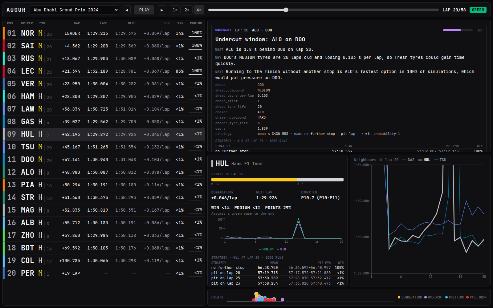

# AUGUR — F1 Race Intelligence

AUGUR replays historical Formula 1 races lap by lap and serves the race state at any lap through an HTTP API. Nothing served at lap N reads data from laps after N.

## Data source

Race data comes from the public [OpenF1](https://openf1.org) API (historical sessions from 2023 onward). **No account or subscription is needed.** Ingest needs network access; the API and tests run offline afterwards.

Two lap columns are derived because OpenF1 has no per-lap equivalent:

- `track_status` uses FastF1-style codes — `1` green, `2` yellow, `4` safety car, `5` red flag, `6` virtual safety car — and is the most severe status from OpenF1 race control messages active during the lap.
- `is_accurate` is true when the lap has a lap time, is not lap 1, and is neither a pit-in nor a pit-out lap.

Race positions are computed from laps completed and session time at the end of each driver's last lap, so they can differ from official timing around pit stops.

## Setup

```bash
python3 -m venv backend/.venv
backend/.venv/bin/pip install -e "backend[dev]"
```

On Ubuntu without `python3.X-venv`, create the venv with `python3 -m venv --without-pip backend/.venv` and install pip into it with any other pip: `python -m pip --python backend/.venv/bin/python install pip`.

## Ingest races

```bash
backend/.venv/bin/python -m augur.ingest --year 2024 --rounds 1 24
```

Output, one line per race:

```
ingested 2024-01-bahrain-grand-prix: 20 drivers, 57 laps
ingested 2024-24-abu-dhabi-grand-prix: 20 drivers, 58 laps
```

- Rounds are counted over the year's non-cancelled races in date order.
- Data goes to `data/` at the repository root (override with `--data-dir`): `data/races/<race_id>/laps.parquet`, `data/augur.sqlite`, and the response cache `data/openf1-cache/`.
- Re-running replaces the race. A failed round prints `failed <year> round <round>: <reason>`, stores nothing for that round, and the command exits 1.

## Run the API

```bash
backend/.venv/bin/uvicorn augur.api:app --reload
```

| Endpoint | Returns |
|---|---|
| `GET /api/health` | `{"status": "ok"}` |
| `GET /api/races` | ingested races ordered by year, round |
| `GET /api/races/{race_id}/state?lap=N` | track status and per-driver position, gap, tyre, stint, pit count at lap N |
| `GET /api/races/{race_id}/laps?lap=N[&driver=VER]` | normalized lap rows with lap ≤ N |
| `GET /api/races/{race_id}/predictions?lap=N` | per driver: predicted next lap time, recent pace, tyre degradation per lap, cliff flag |
| `GET /api/races/{race_id}/strategy?lap=N&driver=VER[&runs=1000&seed=42]` | pit strategies compared by a seeded Monte Carlo simulation (mean, p10, p90, win probability) |
| `GET /api/races/{race_id}/events?lap=N` | precomputed race events up to lap N with What / Why / Next analysis |

The prediction and event endpoints use the model named by `AUGUR_MODEL` (default `lightgbm`); an unknown or untrained model returns HTTP 503.

```bash
curl "localhost:8000/api/races/2024-01-bahrain-grand-prix/state?lap=10"
```

CORS allows `http://localhost:5173` (the dashboard dev server).

## Train the model and analyze races

```bash
# training races, test races, and the 2023 races used only for circuit priors
backend/.venv/bin/python -m augur.ingest --year 2024 --rounds 1 2 3 4 5 6 7 8 9 10 11 24
backend/.venv/bin/python -m augur.ingest --year 2023 --rounds 1 2 3 5 6 7 8 9 16 22
backend/.venv/bin/python -m augur.train            # --model lightgbm --train 2024:2-11 --test 2024:1,24
backend/.venv/bin/python -m augur.analyze --race 2024-01-bahrain-grand-prix
backend/.venv/bin/python -m augur.analyze --race 2024-24-abu-dhabi-grand-prix
```

Ingesting these 22 races took 575 s on one machine (measured 2026-11-19, OpenF1 throttled to 3 requests/s); later runs read `data/openf1-cache/`. To plug in your own lap-time model, see [docs/swap-model.md](docs/swap-model.md).

## Run the dashboard

The dashboard (`frontend/`, React + Vite) replays a race lap by lap: timing list with win and podium probabilities, the newest most severe event with its analysis, a focus-driver panel, and a lap-time chart. It needs Node.js 20 or newer and the API running on port 8000.

```bash
# terminal 1: the API
backend/.venv/bin/uvicorn augur.api:app --reload

# terminal 2: the dashboard on http://localhost:5173
npm --prefix frontend install
npm --prefix frontend run dev
```

The Vite dev server proxies `/api` to `http://localhost:8000`, so the dashboard uses relative URLs. It requests data only for the lap on the slider and cancels requests for laps it has moved past.

| Control | Action |
|---|---|
| Race selector | switch race (restarts at lap 1) |
| Slider, ◀ / ▶, Left / Right | move one lap |
| PLAY / Space, 1× 2× 4× | play one lap per 1000 / 500 / 250 ms |
| Timing row | set the focus driver (panel, chart, highlights) |
| Event timeline marker | jump to that event's lap and pause |

If the API is not running, the dashboard shows how to start it; if no race is ingested or a race is not analyzed, it shows the command to run.



## LLM commentary (optional)

AUGUR can add a short commentator-style paragraph to each analyzed event. The dashboard shows it first in the event card, labelled `AUGUR commentary · <model>`. Everything else works without it: analysis, tests, and the benchmark never call an LLM.

Commentary is generated once per race and cached in `data/augur.sqlite`; the API only reads that cache. The LLM sees the event type, lap, drivers, evidence, and template text, never the event's outcome. A text is kept only if every number in it matches the event's lap, evidence, or template text and every three-letter driver code belongs to the event; otherwise the command prints `rejected <event_id>: <reason>` and the event keeps only the template analysis.

```bash
# after augur.analyze; reads the variables below (for example from a .env file)
set -a; source .env; set +a
backend/.venv/bin/python -m augur.narrate --race 2024-24-abu-dhabi-grand-prix
# narrated 2024-24-abu-dhabi-grand-prix: <ok> ok, <rejected> rejected, <failed> failed, <cached> cached
```

Run it again to retry rejected or failed events; cached events are skipped. Restart the API after changing the narrator variables, since it serves only commentary cached for the current settings.

| Variable | Default | Meaning |
|---|---|---|
| `AUGUR_NARRATOR` | `gemini` | `openai_compat` (any OpenAI-compatible server), `gemini`, or `none` |
| `AUGUR_LLM_BASE_URL` | — | `openai_compat` server, for example `http://<host>:<port>/v1` (required for `openai_compat`) |
| `AUGUR_LLM_MODEL` | `glm` | model id on that server (see `GET <base URL>/models`) |
| `AUGUR_LLM_API_KEY` | — | optional; sent as `Authorization: Bearer <key>` |
| `GEMINI_API_KEY` | — | Gemini API key (required for `gemini`) |
| `GEMINI_MODEL` | `gemini-flash-latest` | Gemini model id; set a fixed id for reproducible text |
| `AUGUR_COMMENTARY_LANG` | `en` | `en` or `zh-TW` |

Without the required setting the command prints `<VARIABLE> not set; nothing generated` and exits 0; with `AUGUR_NARRATOR=none` it prints `narrator none; nothing generated`. If the server cannot be reached (for example off the university network), it stops after 3 connection errors in a row and counts the untried events as failed instead of waiting out the 120 s timeout for each one.

Measured on 2024 Abu Dhabi (116 events, 2026-11-20) with `openai_compat` and a self-hosted `glm` server: the first run gave 92 ok, 10 rejected, 14 failed (12 HTTP 503 in a burst, 2 timeouts) in 11 min 21 s; after the grounding check started accepting the event's own lap, a rerun gave 24 ok, 0 rejected, 0 failed, 92 cached, so all 116 events have commentary. Texts were 43–68 words (median 57); 24 exceeded the prompt's 60-word limit.

## Model results

The lap-time model predicts each driver's next clean lap as their recent pace (median of the last 3 clean laps) plus a predicted delta. The baseline predicts a delta of 0. Numbers are mean absolute error on clean laps of the test races, from `data/models/lightgbm_metrics.json` (trained 2026-11-19):

| Model | MAE (s) | Test laps |
|---|---|---|
| `lightgbm` | 0.305 | 1,773 |
| `baseline` (next lap = recent pace) | 0.380 | 1,773 |

- **Split:** train on 2024 rounds 2–11 (8,161 laps), test on 2024 round 1 (Bahrain) and round 24 (Abu Dhabi). The circuit degradation prior for each race comes from the 2023 race at the same location; OpenF1 has no earlier data, so Shanghai and Imola (no 2023 race) have no prior: 1,376 of 8,161 training laps (16.9%).
- **Caveat:** the training races come after test race 1 in time, so the model has seen 2024 car behaviour from later in the season. No lap of a test race is used for training.

Events precomputed with `lightgbm`, before and after tuning two rules (measured 2026-11-19): a tyre degradation warning now needs 8 clean laps in the stint instead of 5 (most warnings had fired at exactly 5 laps, where the line fit is noisy), and a position change is no longer reported for a driver on their own pit-in or pit-out lap. The other thresholds in `backend/src/augur/config.py` are untuned first estimates.

| Race | Pace drop | Tyres fading | Undercut window | Position change | Total |
|---|---|---|---|---|---|
| 2024 Bahrain, before | 27 | 58 | 40 | 76 | 201 |
| 2024 Bahrain, after | 27 | 48 | 40 | 37 | 152 |
| 2024 Abu Dhabi, before | 23 | 37 | 42 | 43 | 145 |
| 2024 Abu Dhabi, after | 23 | 32 | 42 | 19 | 116 |

## Benchmark your model

One command scores a lap-time model on the fixed benchmark races (2024 Bahrain and 2024 Abu Dhabi) and writes `bench/<model>.json`:

```bash
python -m augur.train --model baseline       # once, if the baseline has not been trained
python -m augur.bench --model lightgbm
python -m augur.bench --model baseline
```

Results on 2026-11-20 (`bench/lightgbm.json`, `bench/baseline.json`):

```
lightgbm: podium skill -15.9% vs current order, lap times beat baseline by 19.8%, event hit rate 44% (61/137)
baseline: podium skill 61.7% vs current order, lap times match baseline (0.0%), event hit rate 44% (61/137)
```

- **Podium skill** (headline): Brier score of `p_podium` at 25%, 50% and 75% race distance against "the current top 3 finish on the podium". `lightgbm` predicts lap times better than the baseline but its finishing-position probabilities score worse than that simple rule, so the position simulator with `lightgbm` needs work (for example, at lap 13 of Abu Dhabi it gives HUL, then P7, an 83% win chance).
- **Lap times:** mean absolute error against the baseline (next lap = recent pace).
- **Event hit rate:** undercut and degradation calls resolved 8 laps later. Hit / miss / void with `lightgbm`: Bahrain undercut 17 / 18 / 5, degradation 17 / 22 / 9; Abu Dhabi undercut 20 / 14 / 8, degradation 7 / 22 / 3. These rules do not use the lap-time model, so every model gets the same rate.

To plug in your own model, follow [docs/swap-model.md](docs/swap-model.md). At the final lap of a replay, the dashboard's **WRAPPED** button opens the race summary as seven story cards; "Download card" saves each one as a 1080×1920 PNG.

## Test

```bash
backend/.venv/bin/pytest backend                 # offline, a few seconds
backend/.venv/bin/pytest backend --run-network   # also downloads 2024 round 1 from OpenF1
npm --prefix frontend run test                    # dashboard component tests (mocked API)
npm --prefix frontend run build                   # type-check and production build
```

`test_state_unaffected_by_future_laps`, `test_predictions_unaffected_by_future_laps`, and `test_events_unaffected_by_future_laps` prove that state, predictions, and events at lap N do not change when laps after N are altered.
