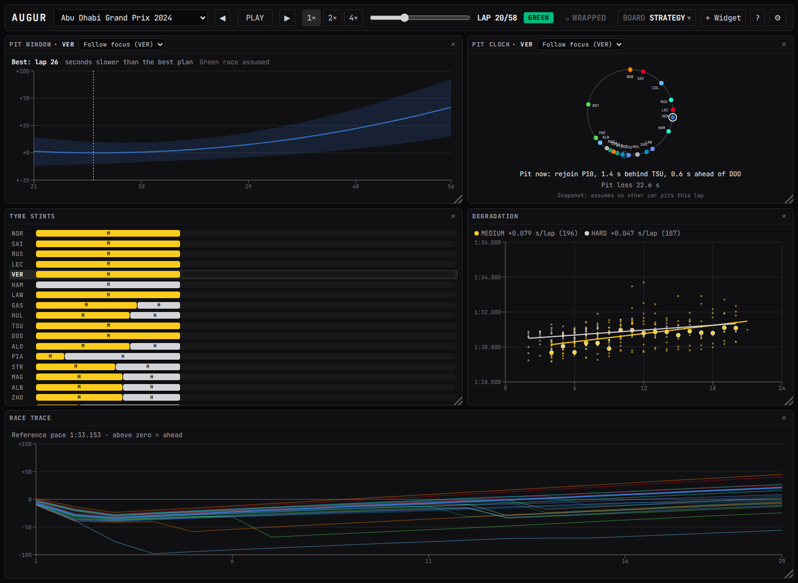
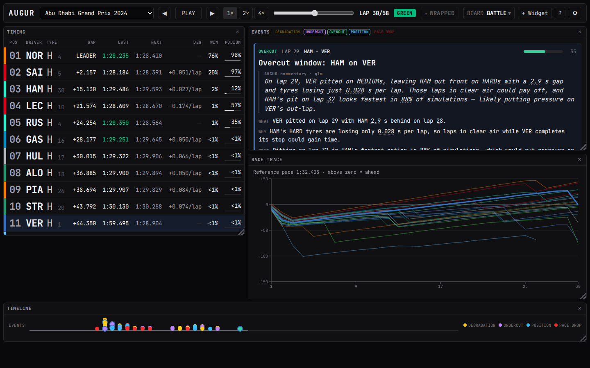
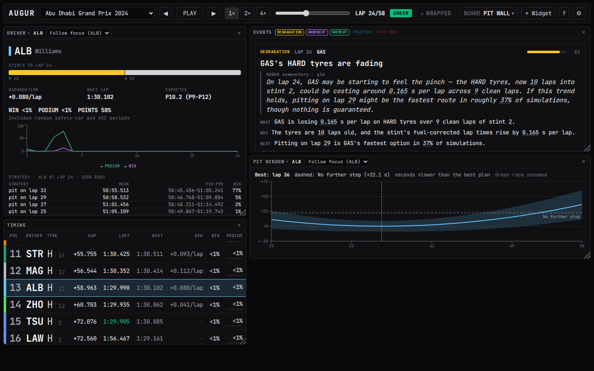
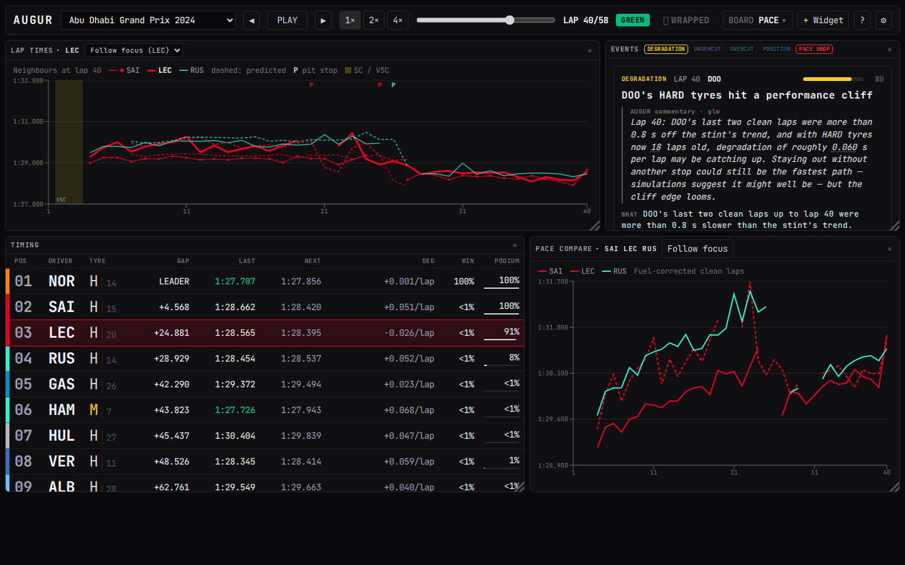
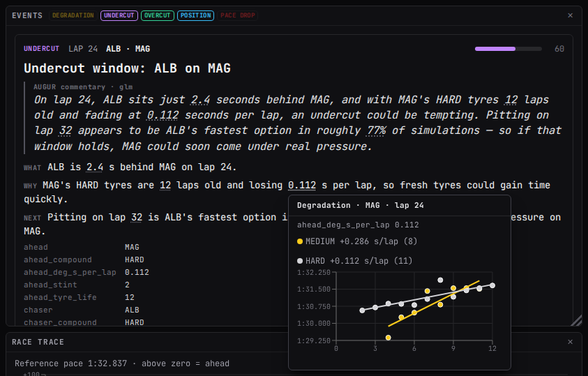
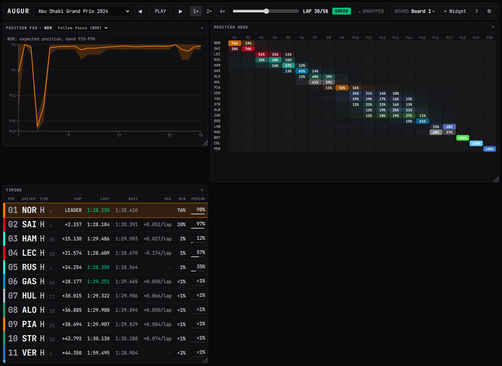
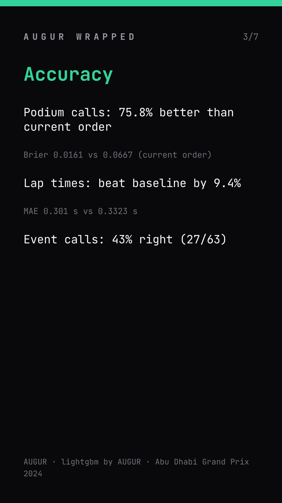
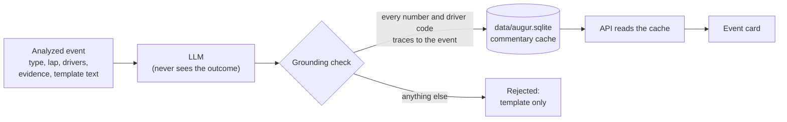

[English](README.md) | **繁體中文**

# AUGUR — F1 Race Intelligence

AUGUR 逐圈重播一場 Formula 1 比賽，並像 pit wall 上的分析師一樣解說：誰可能以第幾名完賽、哪組輪胎正在衰退、什麼時候進站划算，以及比賽中每個關鍵時刻為什麼重要。第 N 圈畫面上的每個數字都只用第 N 圈以前的資料計算，所以重播永遠不知道比賽怎麼結束。你可以換上自己的 lap-time model，並在賽後的「Wrapped」總結裡看到它的 benchmark 分數。

[](https://github.com/Errha-la/augur/actions/workflows/ci.yml) MIT，見 [LICENSE](LICENSE)。



## 快速開始

需要 Python 3.12 以上、Node.js 20 以上、`make`，第一次下載資料時需要網路。不需要任何帳號、訂閱或 API key。

```bash
make setup      # creates backend/.venv, installs the backend with dev extras, runs npm ci in frontend/
make demo       # ingests 22 races from OpenF1, trains lightgbm, analyzes 2024 Bahrain and Abu Dhabi
make dev-api    # terminal 1: the API on http://localhost:8000
make dev-web    # terminal 2: the dashboard on http://localhost:5173
```

打開 http://localhost:5173 選一場比賽。`make test` 會跑離線的 backend 測試和 frontend 測試。

- 第一次 `make demo` 會從公開的 [OpenF1](https://openf1.org) API 下載資料：2026-11-19 花了 575 s；2026-11-22 OpenF1 很慢，總共跑了四次（合計 1,534 s）。如果某一站失敗（例如 OpenF1 timeout），再跑一次 `make demo` 即可，已下載的回應會快取在 `data/openf1-cache/`。
- 如果 `python3 -m venv` 失敗或 venv 裡沒有 pip（Ubuntu 沒裝 `python3.X-venv`），`make setup` 會印出替代指令並停止；見[手動安裝](#手動安裝)。
- LLM 賽評是選用功能，不在 `make demo` 裡；見[LLM 賽評](#llm-賽評選用)。

## 功能

所有截圖：2024 阿布達比大獎賽，model `lightgbm`，在本機跑真實 API。

### 逐圈重播



選一場比賽後可以逐圈移動，或用 1×、2×、4× 播放。在第 N 圈，dashboard 只顯示第 N 圈結束時已知的資訊：名次、差距、輪胎、lap-time model 對每位車手下一圈的預測、目前為止偵測到的事件，以及完賽名次機率。

| 操作 | 功能 |
|---|---|
| 比賽選單 | 切換比賽（從第 1 圈開始） |
| 滑桿、◀ / ▶、Left / Right | 前後移動一圈 |
| PLAY / Space、1× 2× 4× | 每 1000 / 500 / 250 ms 播放一圈 |
| Timing 列 | 設定焦點車手（focus panel、車手 widget、標示） |
| 事件時間軸標記 | 跳到該事件的圈數並暫停 |

API 沒啟動時，dashboard 會告訴你怎麼啟動；如果還沒 ingest 任何比賽，或比賽還沒 analyze，會顯示該執行的指令。

### 白板：board 與 widget

Dashboard 是一塊 12 欄格線的白板，上面擺放 widget。可以選預設 board，也可以自己組：

| Board | Widget |
|---|---|
| **BATTLE**（預設） | timing、events（名次變化、undercut 與 overcut 窗口）、race trace、timeline |
| **PIT WALL** | 焦點車手、events（輪胎衰退、undercut 與 overcut 窗口）、pit window、timing |
| **PACE** | lap times、events（掉速、輪胎衰退）、timing、pace compare |
| **STRATEGY** | pit window、pit clock、tyre stints、degradation、race trace |

- 拖曳 widget 的標題列可以移動，拖曳右下角可以縮放；選取 widget 後，方向鍵移動、Shift+方向鍵縮放。
- 「+ Widget」可以加入下方 13 種 widget 的任何一種，同一種可以加入多次。車手類 widget（Driver、Lap times、Pit clock、Pit window、Position fan）可以各自跟隨焦點車手或固定某位車手，例如讓 LEC 和 PIA 的 pit window 並排。
- 「New blank board」建立空白 board。Board 只存在這個瀏覽器（`localStorage`，key 為 `augur.boards.v1`）；用 Export / Import 分享（`augur-board-<name>.json`，最多 100 KB、24 個 widget）。Board 不會存到伺服器。
- 狀態列的「?」會重新打開四步驟導覽。





#### 每張圖顯示什麼、怎麼算

每個 widget 都向 API 要求重播圈數 N 的資料，拿到的數字只用第 N 圈以前的圈速計算。全篇共用兩個定義：

- **Clean lap**（`augur.features.clean_mask`）：有圈速、不是第 1 圈、不是進站圈或出站圈、綠旗、乾胎，而且比這場比賽之前最快的 clean lap 慢不超過 10%。
- **Fuel-corrected 圈速**（`augur.features.fuel_corrected`）：假設車上仍是滿油時的圈速，`lap time + 0.03 s/kg × 110 kg ÷ race laps × (lap − 1)`，讓比賽後段的圈速能和前段比較。

| Widget | 顯示 | 讀取 | 計算方式 |
|---|---|---|---|
| Timing | 名次、差距、輪胎與胎齡、上一圈與預測下一圈、輪胎衰退、奪冠與登台機率 | `/state`、`/predictions`、`/positions` | 名次依完成圈數，再依每位車手最後一圈結束時的 session time 排序（進站前後可能和官方計時不同）；下一圈和衰退同 Lap times；機率來自下方的名次模擬。 |
| Events | 含 what / why / next 分析與選用 LLM 賽評的事件卡 | `/events` | 規則式偵測器逐圈執行：輪胎衰退警告（一段 stint 至少 8 個 clean lap、擬合斜率至少 0.10 s/lap）、undercut 與 overcut 窗口、名次變化、掉速。文字是固定 template；事件結果要等重播到它的判定圈才會出現。 |
| Driver | 焦點車手：stints、輪胎衰退、預測下一圈、預期名次與 P10-P90 範圍、奪冠 / 登台 / 得分（前 10）機率與歷史曲線，以及進站策略表 | `/state`、`/predictions`、`/positions/history`、`/strategy` | 機率來自名次模擬。策略表比較四個候選計畫：在第 N+1、N+3、N+5 或 N+8 圈進站（用過兩種乾胎後再加「不再進站」），各跑 1,000 次 seeded 模擬；「win」是該計畫在所有模擬中最快的比例。假設比賽一路綠旗到終點。 |
| Lap times | 焦點車手與前後車的圈速，虛線為 model 的預測圈速；第 1 圈、進站圈、出站圈，以及安全車 / 虛擬安全車 / 紅旗圈在線上留空；`P` 以車手顏色標示每次進站，安全車 / 虛擬安全車 / 紅旗圈加上底色 | `/laps`、`/predictions` | 預測 = 近期配速（最近 3 個 clean lap 的中位數）+ lap-time model 預測的變化量（預設 `lightgbm`；可替換，見[換上你的 model](#換上你的-model)）。Y 軸只依畫出來的圈計算範圍。 |
| Timeline | 整場比賽的事件標記 | `/events` | 點擊標記會跳到該圈並暫停。 |
| Race trace | 每位車手每圈相對參考配速領先（+）或落後（−）的時間 | `/trace` | Race time = session time − 起跑時間，起跑時間取所有車手（第 1 圈 session time − 第 1 圈圈速）的中位數。參考配速 = 所有車手在最後一個有計時的圈時，race time ÷ 圈數的中位數。水平線代表維持參考配速；往上代表更快。 |
| Pit clock | 每台車和領先者的差距，以及車手現在進站會回到哪裡 | `/rejoin` | 回場差距 = 自己和領先者的差距 + pit loss。Pit loss = 本場目前所有進站（進站圈 + 出站圈 − 2 × 該車手近期配速）的中位數；還沒有人進站時為 22 s。假設其他車不進站；是快照，不是預測。 |
| Pit window | 在之後每一圈進站的預期剩餘比賽時間，以及最佳進站圈 | `/pit-window` | 使用下方的策略模擬器，每個候選進站圈跑 1,000 次（seed 42），每次抽一個標準差 1.5 s 的 pit loss。用過兩種乾胎後才提供「不再進站」，規則和策略表相同。它掃描之後的每一圈，而策略表和事件文字只比較 N+1、N+3、N+5、N+8，所以最佳圈可能不同（PIT WALL 截圖中 ALB 在第 24 圈：第 36 圈對第 32 圈）。假設綠旗。 |
| Tyre stints | 每位車手到目前為止的 stints，依輪胎配方上色 | `/stints` | 由圈速資料取得配方、起始圈、結束圈，以及 stint 開始時的胎齡。 |
| Degradation | 各乾胎配方的 fuel-corrected clean lap 對胎齡的散佈圖與擬合線 | `/degradation` | 每種配方做最小平方法擬合 `time = intercept + slope × tyre age`，至少 4 個點才畫線；斜率就是每圈衰退秒數。 |
| Pace compare | 最多四位車手的 fuel-corrected clean lap | `/degradation` | 和 Degradation 相同的點，篩選成選定的車手（或焦點車手與前後車）。 |
| Position fan | 每圈的預期完賽名次與 P10-P90 範圍 | `/positions/history` | 每一圈儲存的名次模擬結果：所有模擬的平均完賽名次，以及第 10 和第 90 百分位數。 |
| Position odds | 每位車手每個完賽名次的機率（熱圖） | `/positions/distribution` | 名次模擬中，該車手以 P1、P2⋯⋯完賽的比例。 |

**名次模擬**（`augur.positions`，1,000 次 seeded 模擬，從第 N + 1 圈模擬全場到終點）。一位車手模擬的一圈是

`recent pace + model delta × 0.7^(laps ahead − 1) + degradation × added tyre age − fuel burn + noise`

- Lap-time model 預測的變化量每圈乘上 0.7 逐漸淡出，避免單圈預測變成整場的固定差距。
- 只有當車手這段 stint 至少有 8 個 clean lap 且斜率不為負時，才用他自己的衰退擬合；否則用該配方的保守斜率（各 stint 擬合的中位數，往賽道先驗收斂），並一律限制在 0-0.20 s/lap。
- 每次模擬為每位車手抽一個持續整場的配速偏移（標準差 0.30 s），所以各車不是每圈獨立擲骰子。
- 在前車後方不到 1.0 s 完成一圈的車，下一圈損失 0.4 s（dirty air）。
- 模擬進站會加上 pit loss，換到下一種配方並重設胎齡，配速依配方偏移（SOFT −0.6 s、MEDIUM 0、HARD +0.4 s 每圈）。
- 一次模擬可能出現一次安全車（每圈 0.8% 機率，持續 4 圈）或虛擬安全車（每圈 0.6%，持續 3 圈）：所有車圈速變慢 1.35× / 1.25×，進站成本變成 0.5× / 0.6× pit loss，安全車期間差距縮到 1.0 s，還需要進站的車手有 0.8 的機率趁這時進站。
- 每次模擬的完賽順序依完成圈數，再依總時間決定。
- 變化量淡出係數（0.7）和配速偏移（0.30 s）只用 2024 第 12 到 23 站以 `augur.tune_sim` 調整；安全車和虛擬安全車機率是估計值（每場 57 圈約 0.45 次安全車、0.35 次虛擬安全車），並和這些比賽的 race control 次數比對過。都沒有用 benchmark 比賽擬合（見 [Benchmark](#benchmark)）。

Pit window 和策略表背後的**策略模擬器**（`augur.strategy`）只模擬一位車手：`lap time = fuel-corrected pace at tyre age 0 + degradation × tyre age − fuel burn + noise`；進站會加上 pit loss、重設胎齡，並依配方改變配速。它跑 1,000 次 seeded 模擬，以總比賽時間比較各進站計畫，假設綠旗。

### 可點擊數字的比賽事件



規則式事件引擎逐圈走過整場比賽，用分析師的口吻把每個事件寫成**what**（發生什麼）、**why**（為什麼重要）、**next**（接下來可能怎樣）：只談機率，從不下指令。

| 事件 | 觸發條件（門檻在 `backend/src/augur/config.py`） |
|---|---|
| 輪胎衰退警告 | 一段 stint 的 fuel-corrected 圈速在至少 8 個 clean lap 中每圈至少變慢 0.10 s，或最後兩個 clean lap 比 stint 趨勢慢超過 0.8 s（「懸崖」） |
| Undercut 窗口 | 車手落後正前方車輛 2.5 s 以內，前車輪胎至少 12 圈，且兩車最近 3 圈都沒進站 |
| Overcut 窗口 | 正前方車輛進站，而落後 3.0 s 以內的車手留在場上，輪胎每圈衰退最多 0.05 s |
| 名次變化 | 車手一圈內上升或下降至少 2 名，或出現新的領先者 |
| 掉速 | 一個 clean lap 比 model 預測慢超過 1.0 s |

- Undercut 和輪胎衰退的判斷會在 8 圈後得到結果（追擊者有沒有超前、車手有沒有進站），重播到那一圈才顯示；[benchmark](#benchmark) 把它們算成事件命中率。
- 來自事件 evidence 的數字（差距、胎齡、衰退、圈速、進站圈與勝率、名次）在分析和賽評裡都有底線。點一下會打開一張小圖，顯示該數值在事件那一圈、事件相關車手的資料：race trace、tyre stints、degradation、lap times、pit window 或 position fan。按 Escape、點外面或再點一次即可關閉。
- 這些連結由 backend 在 `/events` 裡計算（`links.what` / `why` / `next` / `commentary`，以 code point 為位移），使用和賽評 grounding 檢查相同的數字規則，所以只有能追溯到 evidence 欄位的數字才會有連結。事件圈數和 template 常數維持純文字，popover 也不會讀取事件之後的圈。
- 每個 Events widget 都可以用標題列的 chip 篩選事件類型。

### 完賽名次預測



主要輸出是每位車手每個完賽名次的機率，來自對剩餘比賽的 Monte Carlo 模擬（每圈 1,000 次 seeded 模擬，包含隨機的安全車和虛擬安全車）。Timing 列表顯示奪冠和登台機率，Driver widget 顯示完整機率和預期名次，Position fan 顯示預期名次逐圈的變化，Position odds 用熱圖呈現全場。模擬怎麼運作見[圖表目錄](#每張圖顯示什麼怎麼算)；分數表現見 [Benchmark](#benchmark)。

### Race Wrapped



在最後一圈，**WRAPPED** 會為焦點車手打開七張限時動態卡片的比賽總結：Summary、Podium Call、Accuracy、Best Call、Biggest Miss、Biggest Moment，以及車手自己的卡。「Download card」會把每張存成 1080×1920 PNG，可以直接發 Instagram 限時動態。

Accuracy 卡只用這一場比賽為目前使用的 model 評分：圖中是 2024 阿布達比的 `lightgbm`（podium Brier 0.0161，「目前名次維持不變」為 0.0667；lap-time MAE 0.301 s 對 0.3323 s；事件判斷 63 次中對 27 次），和 `bench/lightgbm.json` 裡阿布達比的數字相同。換上你自己的 lap-time model，Wrapped 就會顯示你的分數。

<br clear="right">

### LLM 賽評（選用）

AUGUR 可以為每個事件加上一段賽評口吻的短文，由你指定的任何 LLM 撰寫。Dashboard 把它放在事件卡最上方，標示 `AUGUR commentary · <model>`（見上方的事件截圖）。其他功能都不依賴它：分析、測試、benchmark 和 API 都不會呼叫 LLM，沒有賽評時事件仍保留 template 分析。

**Template 與 LLM 對照。** 2024 阿布達比，第 24 圈，undercut 窗口，ALB 追 MAG（model `lightgbm`，賽評 `glm`，語言 `zh-TW`），從 `data/augur.sqlite` 原文引用、未經修改：

| Template 分析（固定規則） | AUGUR 賽評（LLM） |
|---|---|
| **What** ALB is 2.4 s behind MAG on lap 24.<br>**Why** MAG's HARD tyres are 12 laps old and losing 0.112 s per lap, so fresh tyres could gain time quickly.<br>**Next** Pitting on lap 32 is ALB's fastest option in 77% of simulations, which would put pressure on MAG. | 第24圈，ALB僅落後MAG約2.4秒，兩者都使用HARD胎且胎齡同為12圈。若MAG的輪胎以每圈0.112秒的速度衰退，ALB在第32圈進站換上新胎，在模擬中約有77%的機率是最佳選擇，或許能對MAG形成威脅，但結果仍難料。 |

LLM 改變的是口吻，不是事實：它文字裡的每個數字都是 template 原本就有的。這段中文還補上了「兩車胎齡同為 12 圈」：追擊者的胎齡在 evidence 裡（`chaser_tyre_life`），但 template 沒有寫出來。

**一段文字怎麼出現在畫面上。**



- LLM 拿到事件類型、圈數、車手、evidence 和 template 文字，但永遠看不到事件結果，所以不可能把未來洩漏進重播。
- 只有當文字裡每個數字都對得上事件的圈數、evidence 或 template 文字，而且每個三字母車手代號都屬於這個事件時，才會保留；否則 `augur.narrate` 印出 `rejected <event_id>: <reason>`，這個事件不存任何賽評。
- 賽評由 `augur.narrate` 為每場比賽產生一次並快取；API 只讀快取，所以 dashboard 永遠不用等 LLM。

2026-11-23 在 2024 阿布達比（118 個事件）以自架 `glm` server 實測：

| 語言 | 第一次 | 重跑 | 長度 |
|---|---|---|---|
| English | 27 ok, 0 rejected, 2 failed (timeouts), 89 cached | 2 ok | 43–72 words, median 57 (25 over the prompt's 60-word limit) |
| 繁體中文 | 117 ok, 1 rejected (a number not in the evidence), 0 failed | 1 ok | 74–128 characters, median 101 (8 over the 120-character limit) |

最後 118 個事件在兩種語言都有通過 grounding 的賽評。英文那次重新產生了 27 段：比賽用重新校準後的模擬器重新 analyze 之後，這 27 段已無法通過 grounding 檢查。因為 `augur.narrate` 會跳過已快取的事件，所以先把它們從快取刪除再重跑。

#### 產生賽評

```bash
# after make demo (or augur.analyze); needs the narrator variables below
AUGUR_NARRATOR=openai_compat AUGUR_LLM_BASE_URL=http://<host>:<port>/v1 AUGUR_LLM_MODEL=<model> \
  backend/.venv/bin/python -m augur.narrate --race 2024-24-abu-dhabi-grand-prix
# narrated 2024-24-abu-dhabi-grand-prix: <ok> ok, <rejected> rejected, <failed> failed, <cached> cached
```

再跑一次可以重試被拒絕或失敗的事件；已快取的事件會跳過。啟動 API（`make dev-api`）時要帶同樣的 narrator 變數，因為它只提供目前設定下快取的賽評。變數也可以寫在 git-ignored 的 `.env` 檔，用 `set -a; source .env; set +a` 載入。

#### 更換 LLM

| 變數 | 預設 | 說明 |
|---|---|---|
| `AUGUR_NARRATOR` | `gemini` | `openai_compat`（任何 OpenAI-compatible server）、`gemini` 或 `none`（不產生賽評） |
| `AUGUR_LLM_BASE_URL` | — | OpenAI-compatible server 的 base URL，`http://` 或 `https://`，以 `/v1` 結尾（`openai_compat` 必填） |
| `AUGUR_LLM_MODEL` | `glm` | 該 server 上的 model id（見 `GET <base URL>/models`） |
| `AUGUR_LLM_API_KEY` | — | 選填；以 `Authorization: Bearer <key>` 送出 |
| `GEMINI_API_KEY` | — | Gemini API key（`gemini` 必填） |
| `GEMINI_MODEL` | `gemini-flash-latest` | Gemini model id；設定固定 id 才能重現相同文字 |
| `AUGUR_COMMENTARY_LANG` | `en` | `en` 或 `zh-TW`；dashboard 的 Settings 會覆蓋它（存在 `data/settings.json`） |

- **任何 OpenAI-compatible server**（本機的 Ollama、vLLM、LM Studio，或雲端服務）：設 `AUGUR_NARRATOR=openai_compat`，`AUGUR_LLM_BASE_URL` 設成它的 `/v1` base URL，`AUGUR_LLM_MODEL` 設成它提供的 model，需要時再設 `AUGUR_LLM_API_KEY`。AUGUR 用 Python 標準函式庫（不需額外套件）POST 到 `<base URL>/chat/completions`，每個事件最多等 120 s，HTTP 429 和 5xx 會重試兩次，會移除 `<think>` 區塊，連續 3 次連線錯誤就停止（例如 server 不在你的網路內）。
- **Gemini：** `AUGUR_NARRATOR=gemini` 加上 `GEMINI_API_KEY`；固定 `GEMINI_MODEL` 才能重現相同文字。我們實測免費額度的 key 跑不完一整場比賽。
- **關閉：** `AUGUR_NARRATOR=none`，或不設變數：`augur.narrate` 會印出 `<VARIABLE> not set; nothing generated` 並以 0 結束。
- **語言：** 設 `AUGUR_COMMENTARY_LANG=zh-TW`，或在 dashboard 的 Settings 選語言，即可產生繁體中文賽評。
- **切換之後**，重跑 `augur.narrate` 並重啟 API。賽評依事件、model、narrator、LLM model、語言和 prompt 版本分開快取（`augur.narration.cache`），所以舊設定的文字會留在快取裡，切回去就會再出現。

**新增 provider**（給不是 OpenAI-compatible 的 API）。Narrator 是任何具有 `name` 和 `narrate(event) -> str | None` 方法的 class（`augur.narration.base.Narrator`）：

1. 在新的 module 寫好 class 並呼叫 `register(name, factory)`，例如 `backend/src/augur/narration/my_llm.py`（見下方）。
2. 在 `backend/src/augur/narration/__init__.py` 裡、`gemini` 和 `openai_compat` 的 import 旁邊 import 這個 module，名字才會被註冊。
3. 在 `backend/src/augur/narration/serving.py` 的 `_CONFIGURED_MODEL` 加上這個名字，以及一個回傳其 model id 的函式；API 只提供列在這裡的 narrator 的賽評。
4. 用 `AUGUR_NARRATOR=<name>` 執行 `augur.narrate` 和 API。

```python
# backend/src/augur/narration/my_llm.py
import os
from augur.narration.base import MissingSettingError, register
from augur.narration.prompt import build_prompt

class MyNarrator:
    name = "my_llm"
    llm_model = "my-model"          # stored with each text and shown on the card

    def __init__(self):
        self.key = os.environ.get("MY_LLM_KEY")
        if not self.key:
            raise MissingSettingError("MY_LLM_KEY")   # augur.narrate prints "MY_LLM_KEY not set" and exits 0
        self.lang = "en"            # set by augur.narrate from the language setting

    def narrate(self, event):
        prompt = build_prompt(event, self.lang)
        return call_my_llm(prompt, self.key)          # your client; return None on failure

register(MyNarrator.name, MyNarrator)
```

不論你的 narrator 回傳什麼，都會經過 grounding 檢查，所以新 provider 不可能把沒有依據的數字放上畫面。

## Benchmark

**完賽名次預測比「目前名次維持不變」好 49.8%**（podium Brier skill，2024 巴林與阿布達比，`lightgbm`），在十二場保留的 2024 比賽（第 12 到 23 站）上好 4.2%。下面所有數字都來自已 commit 的 `bench/*.json`（2026-11-22 產生，seed 42），可以用本節最後的指令重現。

**主要分數：podium skill。** 在比賽進行 25%、50% 和 75% 時，用 Brier score 評估每位車手模擬出的登台機率 `p_podium` 和他實際是否登台，再和「目前前三名就是最後的頒獎台」這條規則比較：`skill = 1 − Brier(model) ÷ Brier(current order)`。正值代表比這條規則好。

| Benchmark 比賽 | Podium skill | Brier (model / current order) | Log loss (model / current order) | Lap-time MAE (model / baseline) | 事件命中率 |
|---|---|---|---|---|---|
| `lightgbm`，兩場合計 | **49.8%** | 0.0251 / 0.05 | 0.0828 / 0.3463 | 0.305 s / 0.3802 s (19.8% better) | 44.5% (61/137) |
| `lightgbm`，2024 巴林 | −2.2% | 0.0341 / 0.0333 | 0.1016 / 0.2312 | 0.3086 s / 0.4221 s (26.9%) | 34/74 |
| `lightgbm`，2024 阿布達比 | 75.8% | 0.0161 / 0.0667 | 0.064 / 0.4615 | 0.301 s / 0.3323 s (9.4%) | 27/63 |
| `baseline`，兩場合計 | 49.6% | 0.0252 / 0.05 | 0.0844 / 0.3463 | 0.3802 s / 0.3802 s (0.0%) | 44.5% (61/137) |
| `baseline`，2024 巴林 | −8.1% | 0.036 / 0.0333 | 0.1091 / 0.2312 | — | 34/74 |
| `baseline`，2024 阿布達比 | 78.4% | 0.0144 / 0.0667 | 0.0598 / 0.4615 | — | 27/63 |

| 評估比賽（2024 第 12 到 23 站） | Podium skill | Brier (model / current order) | Log loss (model / current order) | Lap-time MAE (model / baseline) | 事件命中率 |
|---|---|---|---|---|---|
| `lightgbm` | 4.2% | 0.0745 / 0.0778 | 0.276 / 0.5382 | 0.419 s / 0.4852 s (13.6% better) | 41.7% (366/877) |
| `baseline` | 2.7% | 0.0757 / 0.0778 | 0.2819 / 0.5382 | 0.4852 s / 0.4852 s (0.0%) | 41.7% (366/877) |

怎麼解讀：

- **Podium skill 大部分來自模擬器，不是 lap-time model。** `baseline` 預測的圈速變化量是 0（下一圈 = 近期配速），它的預測分數幾乎一樣（49.6% 對 49.8%）。`lightgbm` 的圈速預測明顯更準（benchmark 比賽 MAE 低 19.8%，評估比賽低 13.6%），但模擬器會讓這個單圈變化量淡出（每圈乘 0.7），所以它對完賽機率的影響很小。
- **各場分數差異很大。** 兩個 model 在巴林都略差於「目前名次維持不變」，在阿布達比則好很多；評估比賽從 −430.1%（匈牙利）到 65.2%（比利時），新加坡為 −110.3%。
- **高於 0.8 的預測過度自信**：在評估比賽中，73 個平均為 0.936 的預測，實際只有 75.3% 成真。
- **事件命中率**在 8 圈後評估 undercut 和輪胎衰退的判斷（hit / miss / void）。這些規則不使用 lap-time model，所以每個 model 的命中率都一樣。

**方法。** Lap-time model 用 2024 第 2 到 11 站訓練（8,161 個 clean lap；測試是巴林和阿布達比的 1,773 圈）。每條賽道的輪胎衰退先驗來自 2023 年同一賽道的比賽；OpenF1 沒有更早的資料，所以上海和伊莫拉（2023 年沒有比賽）沒有先驗。模擬器的變化量淡出係數和每次模擬的配速偏移只用第 12 到 23 站調整，安全車和虛擬安全車機率也和這些比賽比對過。Benchmark 比賽從不在 model 的訓練資料裡，但訓練比賽在賽季中晚於巴林，所以 model 看過 2024 年稍後的賽車表現。

重現：

```bash
backend/.venv/bin/python -m augur.train --model baseline   # once: the baseline is not part of make demo
backend/.venv/bin/python -m augur.analyze --race 2024-01-bahrain-grand-prix --model baseline
backend/.venv/bin/python -m augur.analyze --race 2024-24-abu-dhabi-grand-prix --model baseline
backend/.venv/bin/python -m augur.bench --model lightgbm   # writes bench/lightgbm.json
backend/.venv/bin/python -m augur.bench --model baseline   # writes bench/baseline.json
```

`--eval` 改為評估評估比賽，並寫出 `bench/<model>-eval.json`；需要先 ingest 2024 第 12 到 23 站（`python -m augur.ingest --year 2024 --rounds 12 13 14 15 16 17 18 19 20 21 22 23`），並用該 model analyze。

## 換上你的 model

只有 lap-time model 可以替換：它把每位車手的下一個 clean lap 預測成近期配速（最近 3 個 clean lap 的中位數）加上一個變化量。實作 `LapTimeModel` protocol、用名稱選取、訓練、analyze，再跑 `augur.bench`；dashboard 和 Wrapped 就會顯示你的 model 的預測和分數。名次模擬器、輪胎衰退和策略維持固定，分數才能互相比較。詳細步驟：[docs/swap-model.md](docs/swap-model.md)。

## API

`make dev-api` 在 http://localhost:8000 提供 API；dashboard 的 dev server 會把 `/api` proxy 過去，CORS 允許 `http://localhost:5173`。每個比賽 endpoint 都接受 `lap=N`，只讀取第 N 圈以前的資料。預測、事件和名次 endpoint 使用 `AUGUR_MODEL` 指定的 model（預設 `lightgbm`；也可以在 dashboard 的 Settings 設定）；未知或未訓練的 model 回傳 HTTP 503。

| Endpoint | 回傳 |
|---|---|
| `GET /api/health` | `{"status": "ok"}` |
| `GET /api/races` | 已 ingest 的比賽，依年份、站別排序 |
| `GET /api/settings`, `PUT /api/settings` | 使用中的 model、賽評語言、資料來源；唯讀的賽評設定（narrator、LLM model） |
| `GET /api/races/{race_id}/state?lap=N` | 賽道狀態，以及每位車手的名次、差距、輪胎、stint、進站次數 |
| `GET /api/races/{race_id}/laps?lap=N[&driver=D]` | lap ≤ N 的標準化圈速資料 |
| `GET /api/races/{race_id}/predictions?lap=N` | 每位車手：預測下一圈時間、近期配速、每圈輪胎衰退、懸崖旗標 |
| `GET /api/races/{race_id}/events?lap=N` | 到第 N 圈為止的事件，含 what / why / next、evidence、已判定的結果、快取的賽評和數字連結 |
| `GET /api/races/{race_id}/positions?lap=N` | 每位車手：奪冠、登台、得分機率，以及預期名次 |
| `GET /api/races/{race_id}/positions/history?lap=N` | 第 N 圈以前每一圈的相同資料，加上 `position_p10` / `position_p90` |
| `GET /api/races/{race_id}/positions/distribution?lap=N` | 每位車手 P1..Pn 的完賽名次機率 |
| `GET /api/races/{race_id}/strategy?lap=N&driver=D[&runs=1000&seed=42]` | 以 seeded Monte Carlo 模擬比較的候選進站計畫（mean、p10、p90、勝率） |
| `GET /api/races/{race_id}/pit-window?lap=N&driver=D[&runs&seed]` | 在之後每一圈進站的模擬剩餘比賽時間，以及最佳進站圈 |
| `GET /api/races/{race_id}/rejoin?lap=N&driver=D` | 和領先者的差距，以及 D 現在進站會回到哪裡 |
| `GET /api/races/{race_id}/trace?lap=N` | race trace：每位車手每圈相對參考配速領先或落後的時間 |
| `GET /api/races/{race_id}/stints?lap=N` | 每位車手到目前為止的 tyre stints |
| `GET /api/races/{race_id}/degradation?lap=N` | 各乾胎配方依胎齡排列的 fuel-corrected clean lap 與擬合線 |
| `GET /api/races/{race_id}/wrapped?lap=N&driver=D` | Wrapped 卡片；最後一圈之前回傳 HTTP 409 |

```bash
curl "localhost:8000/api/races/2024-01-bahrain-grand-prix/state?lap=10"
```

## 資料來源

比賽資料來自公開的 [OpenF1](https://openf1.org) API（2023 年以後的歷史 session）。**不需要帳號或訂閱。** Ingest 需要網路；之後 API、dashboard 和測試都能離線執行。資料存在本機 `data/` 底下（git-ignored）：圈速用 Parquet，比賽 metadata、事件和賽評用 SQLite。沒有資料庫 server。

OpenF1 沒有逐圈的對應欄位，所以有兩個圈速欄位是推導出來的：

- `track_status` 使用 FastF1 風格的代碼：`1` 綠旗、`2` 黃旗、`4` 安全車、`5` 紅旗、`6` 虛擬安全車，取該圈期間生效的 OpenF1 race control 訊息中最嚴重的狀態。
- `is_accurate` 在該圈有圈速、不是第 1 圈、也不是進站圈或出站圈時為 true。

比賽名次依完成圈數，以及每位車手最後一圈結束時的 session time 計算，所以進站前後可能和官方計時不同。

## 手動安裝

和 `make setup`、`make demo`、`make dev-api`、`make dev-web` 相同的步驟，給沒有 `make` 的系統：

```bash
python3 -m venv backend/.venv
backend/.venv/bin/pip install -e "backend[dev]"
npm --prefix frontend ci

# training races, test races, and the 2023 races used only for circuit priors
backend/.venv/bin/python -m augur.ingest --year 2024 --rounds 1 2 3 4 5 6 7 8 9 10 11 24
backend/.venv/bin/python -m augur.ingest --year 2023 --rounds 1 2 3 5 6 7 8 9 16 22
backend/.venv/bin/python -m augur.train            # --model lightgbm --train 2024:2-11 --test 2024:1,24
backend/.venv/bin/python -m augur.analyze --race 2024-01-bahrain-grand-prix
backend/.venv/bin/python -m augur.analyze --race 2024-24-abu-dhabi-grand-prix

backend/.venv/bin/uvicorn augur.api:app --reload   # terminal 1: http://localhost:8000
npm --prefix frontend run dev                      # terminal 2: http://localhost:5173
```

在沒有 `python3.X-venv` 的 Ubuntu 上，用 `python3 -m venv --without-pip backend/.venv` 建立 venv，再用任何其他 pip 把 pip 裝進去：`python -m pip --python backend/.venv/bin/python install pip`。

- Ingest 每場比賽印一行，例如 `ingested 2024-01-bahrain-grand-prix: 20 drivers, 57 laps`。站別依該年度未取消的比賽按日期排序計算。重跑會取代該場比賽；失敗的站會印出 `failed <year> round <round>: <reason>`，該站不存任何資料，指令以 1 結束。
- 資料存在 repo 根目錄的 `data/`（可用 `--data-dir` 覆蓋）：`data/races/<race_id>/laps.parquet`、`data/augur.sqlite`，以及回應快取 `data/openf1-cache/`。

## 已知問題

- **預測校準。** 各場的 podium skill 差異很大（見 [Benchmark](#benchmark)），高於 0.8 的預測在評估比賽中過度自信。
- **策略表和 pit window 可能指出不同的進站圈。** 策略表和事件文字只比較第 N+1、N+3、N+5、N+8 圈進站，pit window 則掃描之後的每一圈，所以它的最佳圈可能落在這些候選之間或之後（阿布達比第 24 圈的 ALB：第 36 圈對第 32 圈）。
- **播放速度。** 在 production build 裡，4× 播放每圈約 354 ms 而不是 250 ms，即使 board 上沒有任何 widget 也一樣（每圈五個 request 加上 render）；STRATEGY board 約 379 到 467 ms（2026-11-23 實測）。
- **LLM 文字品質。** Grounding 檢查只涵蓋數字和車手代號。在 118 段阿布達比英文賽評中，有 7 段 `glm` model 留下雜訊 token（中文、西里爾字母或波蘭文片段，以及 `ALOtekst`、`thistracks` 這類黏在一起的字）；118 段繁體中文賽評沒有。
- **播放中 popover 的位置。** 重播進行中，數字重新 render 時它的圖表 popover 可能會跳動；請先暫停。
- **Pit clock 標籤**在車輛很接近時會重疊。
- **OpenF1 可能很慢。** `augur.ingest` 遇到 HTTP 429 和 5xx 會重試三次（等 2、4、8 s），但 request 超過 60 s timeout 不會重試，所以 OpenF1 很慢時該站會失敗；再跑一次 `make demo` 即可，已下載的回應會留在快取。

## 測試

```bash
make test                                         # offline backend tests + frontend tests
backend/.venv/bin/pytest backend --run-network    # also downloads 2024 round 1 from OpenF1
npm --prefix frontend run build                   # type-check and production build
```

`test_state_unaffected_by_future_laps`、`test_predictions_unaffected_by_future_laps` 和 `test_events_unaffected_by_future_laps` 證明修改第 N 圈之後的圈速時，第 N 圈的狀態、預測和事件都不會改變。CI 在每次 push 到 `main` 和每個 pull request 時，執行 backend 與 frontend 測試和 build（`.github/workflows/ci.yml`）。

## 授權

MIT，見 [LICENSE](LICENSE)。比賽資料版權屬於其所有者，由 [OpenF1](https://openf1.org) 提供；本專案與 Formula 1 無關。
